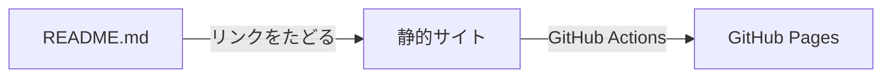

<div class="tsuzuri-hero" align="center">


# Tsuzuri

<p class="tsuzuri-hero-lead">READMEが、そのままドキュメントに。二重に書かなくてよい、READMEのサイトを作ります。</p>

<p class="tsuzuri-hero-sub">コマンド1つで、READMEからテーマ付きのGitHub Pagesのサイトができあがり、あとの更新の手間もかかりません。</p>

```sh
npx github:akilasatolu/tsuzuri#v1 init
```

<p class="tsuzuri-hero-actions"><a class="tsuzuri-button tsuzuri-button-primary" href="docs/getting-started.ja.md">はじめる</a><span class="tsuzuri-sep"> ・ </span><a class="tsuzuri-button" href="#ドキュメント">ドキュメント</a><span class="tsuzuri-sep"> ・ </span><a class="tsuzuri-button" href="https://github.com/akilasatolu/tsuzuri">GitHub</a></p>

[](https://github.com/akilasatolu/tsuzuri/blob/main/LICENSE)
[](https://github.com/akilasatolu/tsuzuri/actions/workflows/ci.yml)

</div>

AIエージェントに導入を任せたいときは、[AIエージェント向けの参考情報](docs/ai-reference.ja.md)を貼り付けるだけです。

## できあがるサイト

このドキュメント自体も、READMEとそこからリンクしたMarkdownから、Tsuzuriで生成し、GitHub Pagesで公開しています: https://akilasatolu.github.io/tsuzuri/

## なぜTsuzuriか

READMEを書けば、それがサイトになります。こんな悩みに答えます。

| こんな悩み | Tsuzuriの答え | 詳しく見る |
|---|---|---|
| READMEとドキュメントサイトに同じ内容を二度書いて、片方が古くなる。 | READMEがそのままサイトになる。リンクをたどるので、二重の管理がない。 | [ページを書く](docs/guides/write-pages.ja.md) |
| ドキュメントツールの学習と設定が重くて、サイトを作らないままになる。 | `init`を1回と、設定ファイル1つだけ。 | [はじめる](docs/getting-started.ja.md) |
| サイトを作っても、ツールや依存の更新への追従が続く。 | 更新はコマンド1つ(`init --update`)。 | [更新する](docs/guides/update.ja.md) |
| 飾りのないサイトは、最初の数秒で離脱される。 | `init`を1回で、テーマ付きのサイトになる。ほかの見た目はギャラリーから選ぶ。 | [ギャラリー](gallery/README.ja.md) |

だから、書くのはREADMEだけです。

## 仕組み



READMEを起点にリンクをたどり、つながったMarkdownと画像を静的なサイトにして、GitHub Pagesで公開します。ページを増やすには、READMEか別のページからリンクを張ります。

## クイックスタート

1. リポジトリの直下で、次のコマンドを実行します。質問は2つ(トリガーブランチと、起点のMarkdownファイル)で、Enterだけで既定値になります。

   ```sh
   npx github:akilasatolu/tsuzuri#v1 init
   ```

   ワークフロー(`.github/workflows/tsuzuri-pages.yml`)と設定ファイル(`.github/tsuzuri/config`)が作られ、ビルドスクリプト一式が`.github/tsuzuri/`にコピーされます。以後のビルドとデプロイは、リポジトリの中だけで完結します。

2. GitHubリポジトリの **Settings → Pages** を開き、Sourceを **GitHub Actions** にします(最初の1回だけ)。
3. `.github/tsuzuri/config`の`TRIGGER_BRANCH`に指定したブランチ(省略した場合は、リポジトリの既定ブランチ。通常は`main`)にpushまたはマージします。

ワークフローがActionsタブで実行され、完了するとサイトが公開されます。URLはSettings → Pagesに表示されます。各手順の詳細は[はじめる](docs/getting-started.ja.md)を見てください。

## 特徴

<div class="tsuzuri-features">
<div class="tsuzuri-feature">
<h3><span class="tsuzuri-sep">【</span><span class="tsuzuri-feature-mark">綴</span><span class="tsuzuri-sep">】</span>リンクをたどって、1つのサイトに</h3>
<p>READMEからリンクでつながったページと画像を自動で集めます。ページを増やすときは、リンクを1本張るだけ。サイトマップの管理は要りません。</p>
</div>
<div class="tsuzuri-feature">
<h3><span class="tsuzuri-sep">【</span><span class="tsuzuri-feature-mark">設</span><span class="tsuzuri-sep">】</span>設定ファイルは1つだけ</h3>
<p>.github/tsuzuri/config を書き換えるだけで動作を変えられます。ワークフローのYAMLを編集する必要はありません。</p>
</div>
<div class="tsuzuri-feature">
<h3><span class="tsuzuri-sep">【</span><span class="tsuzuri-feature-mark">彩</span><span class="tsuzuri-sep">】</span>カスタムスタイル</h3>
<p>標準の見た目から始めても、グラス・エディトリアル・ミニマルなどのカスタムスタイルをギャラリーからダウンロードして、自由に調整してもかまいません。このサイトも自分用のカスタムスタイルで作っています。</p>
</div>
<div class="tsuzuri-feature">
<h3><span class="tsuzuri-sep">【</span><span class="tsuzuri-feature-mark">探</span><span class="tsuzuri-sep">】</span>ナビ・検索・目次</h3>
<p>サイドバーのナビ、サイト内検索、ページ内の目次を自動で作ります。OGP・favicon・sitemap.xml・多言語のサイトにも対応しています。</p>
</div>
</div>

## 見た目を選ぶ

見た目は、`.github/tsuzuri/styles/`にあるCSSファイル(カスタムスタイル)で決まります。パッケージに入っている`default.css`が最初から使われます。ほかのスタイルは、[ギャラリー](gallery/README.ja.md)でダウンロードして`.github/tsuzuri/styles/`に置き、`.github/tsuzuri/config`の`THEME`に指定します(例: `THEME=glass.css`)。

<div class="tsuzuri-carousel">


</div>

[ギャラリーですべてのスタイルを見る](gallery/README.ja.md)。

## 向いている人・向かない人

- **向いている**: READMEと、そこからリンクした数ページがドキュメントになっているプロジェクトで、見た目よく、手間をかけずにGitHub Pagesで公開したい人。
- **向かない**: GitHub Pages以外で公開したいサイト(TsuzuriはGitHub Pages専用です)と、版ごとに別のドキュメントを持ちたい場合(サイトの版は1つで、公開するブランチの内容です)。

## ドキュメント

- [はじめる](docs/getting-started.ja.md): READMEをサイトとして公開する、3つの手順。
- [ギャラリー](gallery/README.ja.md): 見た目を選ぶ。
- [ドキュメント](docs/README.ja.md): ガイドとリファレンス。
- [FAQ](docs/faq.ja.md): よくある困りごとへの答え。
- [掲載・お問い合わせ](docs/contact.ja.md): ギャラリーへの掲載の依頼や、質問・希望。
- [更新履歴(リリースノート)](https://github.com/akilasatolu/tsuzuri/releases)

## ライセンス

[MIT License](https://github.com/akilasatolu/tsuzuri/blob/main/LICENSE)
