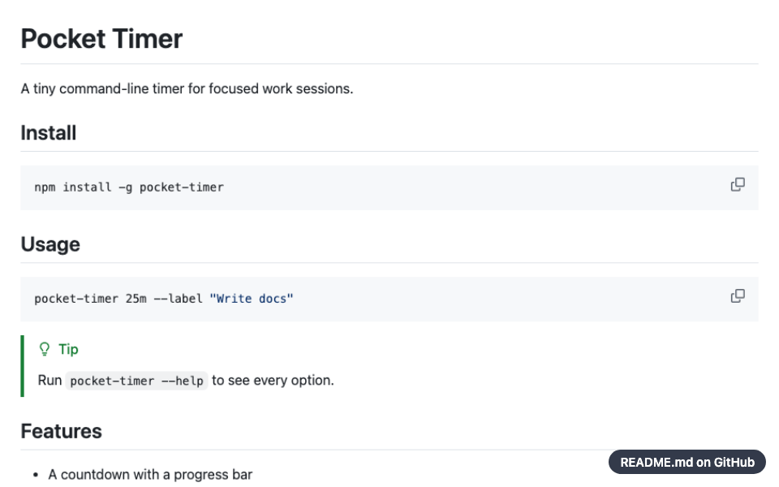
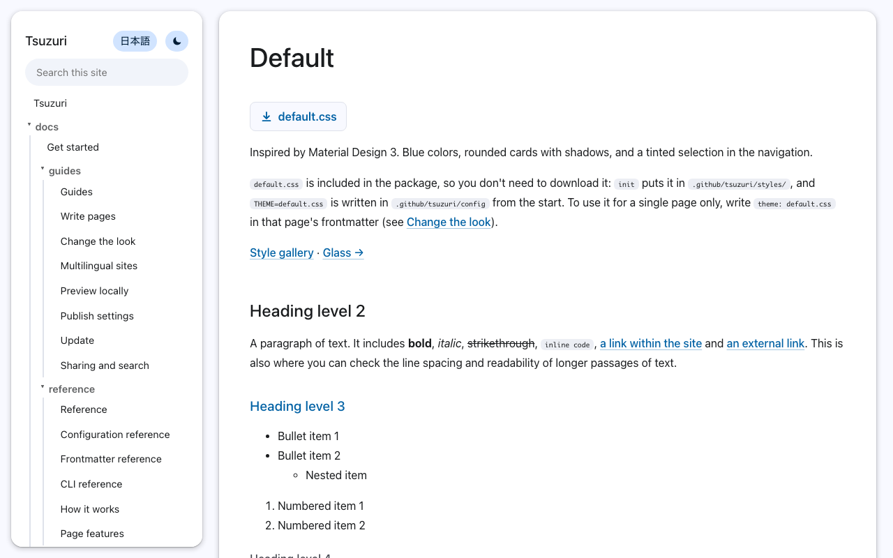
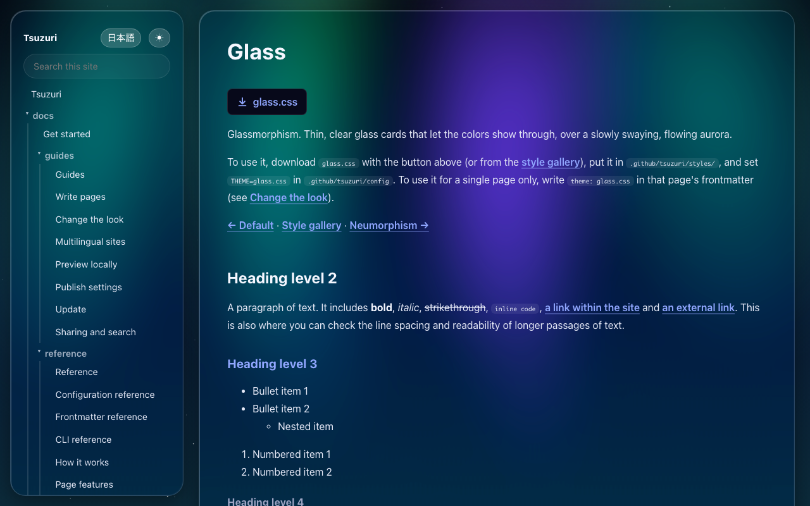
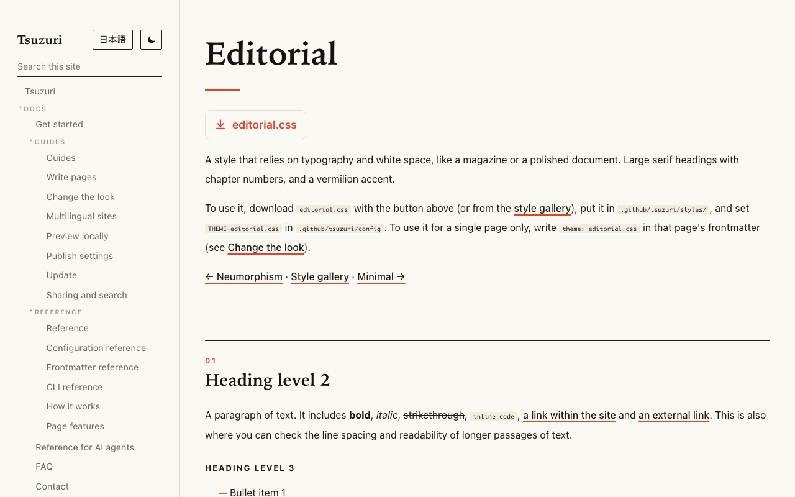
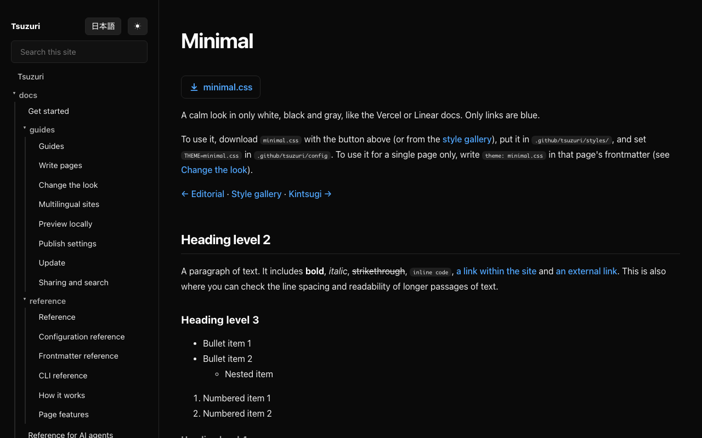
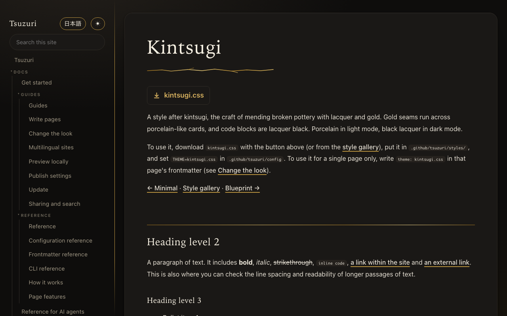
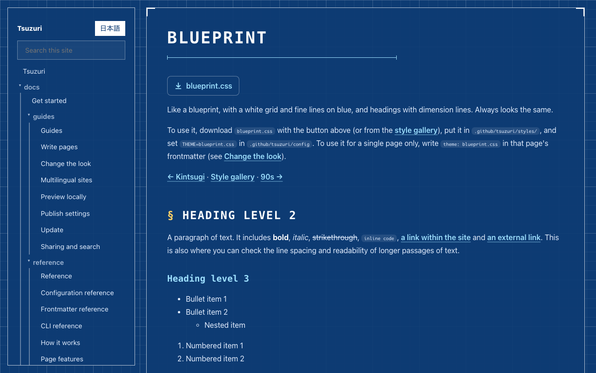

<div class="tsuzuri-hero" align="center">


# Tsuzuri

<p class="tsuzuri-hero-lead">プロダクトづくりに集中したまま。READMEが、そのまま美しいドキュメントサイトに。</p>

<p class="tsuzuri-hero-sub">コマンド1回で準備は完了。あとはブランチにpushするたびに、GitHub Pagesへ公開されます。ドキュメントツールの学習も、デザインづくりも、READMEとの二重管理もいりません。</p>

```sh
npx github:akilasatolu/tsuzuri#v1 init
```

<p class="tsuzuri-hero-actions"><a class="tzr-button tsuzuri-button-primary" href="docs/getting-started.ja.md">はじめる</a><span class="tsuzuri-sep"> ・ </span><a class="tzr-button" href="gallery/style-gallery.ja.md">スタイルギャラリー</a><span class="tsuzuri-sep"> ・ </span><a class="tzr-button" href="https://github.com/akilasatolu/tsuzuri">GitHub</a></p>

<p class="tsuzuri-site-hidden">サイト: <a href="https://akilasatolu.github.io/tsuzuri/ja/">akilasatolu.github.io/tsuzuri/ja</a></p>

[](https://github.com/akilasatolu/tsuzuri/blob/main/LICENSE)

<picture>
<source media="(prefers-reduced-motion: reduce) and (prefers-color-scheme: dark)" srcset="assets/hero/readme-to-site-dark.png">
<source media="(prefers-reduced-motion: reduce)" srcset="assets/hero/readme-to-site-light.png">
<source media="(prefers-color-scheme: dark)" srcset="assets/hero/readme-to-site-dark.gif">

</picture>

</div>

## プロダクトをつくる人のために

Tsuzuriは、こんな人のためのツールです。

- ドキュメントサイトづくりより、プロダクトに時間を使いたい。
- テーマをデザインしなくても、仕上がった見た目のドキュメントにしたい。
- ドキュメントツールを覚えずに、使い方をGitHub Pagesで公開したい。

READMEと、そこからリンクした数ページでプロダクトを説明できていれば、Tsuzuriに要るものはそろっています。

## 3ステップで公開

1. リポジトリの直下で`npx github:akilasatolu/tsuzuri#v1 init`を実行し、2つの質問にEnterで答えます(既定値のまま)。
2. GitHubのリポジトリで **Settings → Pages** を開き、Sourceを **GitHub Actions** にします(最初の1回だけ)。
3. 既定のブランチ(通常は`main`)にpushします。以後は、そのブランチにpushするたびにサイトが更新されます。

手元に入れておくものはありません。ビルドはGitHub Actionsで動きます(`init`の実行だけ、Node.js 20以上が必要です)。手順の詳しい説明は[はじめる](docs/getting-started.ja.md)にあります。

AIエージェントに導入を任せたいときは、[AIエージェント向けの参考情報](docs/ai-reference.ja.md)を貼り付けるだけです。

## 時間は、プロダクトのために

ドキュメントは大事。でも、プロダクトの時間を削ってまで作るものではありません。次のことは、Tsuzuriが引き受けます。

| こんな悩み | Tsuzuriの答え | 詳しく見る |
|---|---|---|
| ドキュメントツールの学習と設定が重くて、サイトを作らないままになる。 | `init`を1回と、設定ファイル1つだけ。ワークフローのYAMLは書かなくてよい。 | [はじめる](docs/getting-started.ja.md) |
| 飾りのないサイトは、未完成に見えて、最初の数秒で離脱される。 | 最初のビルドからテーマ付きで、ライトとダークにも対応。ほかの見た目は、スタイルギャラリーから選べる。 | [スタイルギャラリー](gallery/style-gallery.ja.md) |
| READMEとドキュメントサイトに同じ内容を二度書いて、片方が古くなる。 | READMEがそのままサイトになる。リンクをたどるので、二重の管理がない。 | [ページを書く](docs/guides/write-pages.ja.md) |
| サイトを作っても、ツールや依存の更新への追従が続く。 | 更新はコマンド1つ(`init --update`)。 | [更新する](docs/guides/update.ja.md) |

だから、書くのはREADMEだけです。

## 最初から、見栄えのするサイトに

サイトは最初から、仕上がった見た目で公開されます。変えたいときは、スタイルギャラリーでスタイルを選び、そのCSSファイルを`.github/tsuzuri/styles/`に置いて、`.github/tsuzuri/config`の`THEME`に書きます(例: `THEME=glass.css`)。このサイトは、独自のスタイル(`tsuzuri.css`)を使っています。

<div class="tzr-carousel tsuzuri-showcase">






</div>

[スタイルギャラリーですべてのスタイルを見る](gallery/style-gallery.ja.md)。

## ドキュメントサイトに要るものは、最初から

<div class="tsuzuri-features">
<div class="tsuzuri-feature">
<h3>リンクをたどって、1つのサイトに</h3>
<p>READMEからリンクしたページと画像を、自動で集めます。ページを足すときは、リンクを1つ足すだけ。サイトマップやサイドバーの設定はいりません。</p>
</div>
<div class="tsuzuri-feature">
<h3>迷わず読める</h3>
<p>サイドバー、サイト内検索、ページ内の目次、コードのコピーボタン。GitHubのアラート、脚注、mermaidの図も、GitHubと同じように表示されます。</p>
</div>
<div class="tsuzuri-feature">
<h3>シェアの準備も済んでいる</h3>
<p>OGP画像、favicon、sitemap.xml、AI向けのllms.txt、多言語のサイトに対応しています。</p>
</div>
<div class="tsuzuri-feature">
<h3>安心して公開できる</h3>
<p>リンク切れがあれば、公開の前にビルドを止められます。ビルドの依存は、ハッシュで固定し、npmの署名も確かめます。</p>
</div>
</div>

## 向かないケース

GitHub Pages以外で公開したいサイト(TsuzuriはGitHub Pages専用です)や、版ごとに別のドキュメントを持ちたい場合には向きません(サイトの版は1つで、公開するブランチの内容です)。

## ドキュメント

- [はじめる](docs/getting-started.ja.md): READMEをサイトとして公開する、3つの手順。
- [スタイルギャラリー](gallery/style-gallery.ja.md): 見た目を選ぶ。
- [ガイド](docs/guides/README.ja.md): ページを足す、見た目を変える、多言語にする、など。
- [リファレンス](docs/reference/README.ja.md): 設定・frontmatter・コマンド・ビルドの仕組み。
- [FAQ](docs/faq.ja.md): よくある困りごとへの答え。
- [お問い合わせ](docs/contact.ja.md): 質問や希望。
- [更新履歴(リリースノート)](https://github.com/akilasatolu/tsuzuri/releases)

## ライセンス

[MIT License](https://github.com/akilasatolu/tsuzuri/blob/main/LICENSE)
