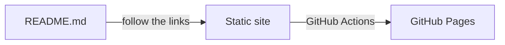

<div class="tsuzuri-hero" align="center">


# Tsuzuri

<p class="tsuzuri-hero-lead">Your README is already your docs — Tsuzuri turns it into a site, with no second copy to maintain.</p>

<p class="tsuzuri-hero-sub">One command gives you a themed GitHub Pages site made from your README, and keeping it up to date takes no extra work.</p>

```sh
npx github:akilasatolu/tsuzuri#v1 init
```

<p class="tsuzuri-hero-actions"><a class="tsuzuri-button tsuzuri-button-primary" href="docs/getting-started.md">Get started</a><span class="tsuzuri-sep"> · </span><a class="tsuzuri-button" href="#documentation">Documentation</a><span class="tsuzuri-sep"> · </span><a class="tsuzuri-button" href="https://github.com/akilasatolu/tsuzuri">GitHub</a></p>

[](https://github.com/akilasatolu/tsuzuri/blob/main/LICENSE)
[](https://github.com/akilasatolu/tsuzuri/actions/workflows/ci.yml)

</div>

Prefer to let an AI agent set it up? Paste the [reference for AI agents](docs/ai-reference.md) into it.

## What you get

This documentation is itself built with Tsuzuri from the README and the Markdown files it links, and published on GitHub Pages: https://akilasatolu.github.io/tsuzuri/

## Why Tsuzuri

Write your README, and that is your site. Here is what it answers.

| Your trouble | Tsuzuri's answer | Details |
|---|---|---|
| You write the same content twice, in the README and on a docs site, and one of them goes stale. | The README is the site: Tsuzuri follows its links, so there is no second copy. | [Write pages](docs/guides/write-pages.md) |
| Docs tools are heavy to learn and set up, so the site never gets made. | One `init` and one settings file. | [Get started](docs/getting-started.md) |
| Even after the site is up, tools and dependencies need upkeep. | Updating is one command: `init --update`. | [Update](docs/guides/update.md) |
| A plain site loses visitors in the first few seconds. | `init` once and you get a themed site. Pick another look from the gallery. | [Gallery](gallery/README.md) |

So all you have to write is the README.

## How it works



Starting from your README, Tsuzuri follows the links, turns the connected Markdown files and images into a static site, and publishes it on GitHub Pages. To add a page, link it from the README or from another page.

## Quick start

1. Run the following command at the root of your repository. It asks two questions (the trigger branch and the starting Markdown file); press Enter to accept the defaults.

   ```sh
   npx github:akilasatolu/tsuzuri#v1 init
   ```

   It creates the workflow (`.github/workflows/tsuzuri-pages.yml`) and the settings file (`.github/tsuzuri/config`), and copies the build script into `.github/tsuzuri/`. After that, builds and deployments run entirely inside your repository.

2. In your GitHub repository, open **Settings → Pages** and set Source to **GitHub Actions** (first time only).
3. Push or merge to the branch set in `TRIGGER_BRANCH` of `.github/tsuzuri/config` (the repository's default branch, usually `main`, if left out).

The workflow runs in the Actions tab, and when it finishes the site is published. The URL is shown under Settings → Pages. [Get started](docs/getting-started.md) explains each step in detail.

## Features

<div class="tsuzuri-features">
<div class="tsuzuri-feature">
<h3><span class="tsuzuri-sep">【</span><span class="tsuzuri-feature-mark">綴</span><span class="tsuzuri-sep">】</span>Follow the links, get one site</h3>
<p>Pages and images linked from the README are collected automatically. To add a page, just add one link. No sitemap to maintain.</p>
</div>
<div class="tsuzuri-feature">
<h3><span class="tsuzuri-sep">【</span><span class="tsuzuri-feature-mark">設</span><span class="tsuzuri-sep">】</span>Just one settings file</h3>
<p>Change the behavior by editing .github/tsuzuri/config. You never need to edit the workflow YAML.</p>
</div>
<div class="tsuzuri-feature">
<h3><span class="tsuzuri-sep">【</span><span class="tsuzuri-feature-mark">彩</span><span class="tsuzuri-sep">】</span>Custom styles</h3>
<p>Start with the default look, or download a custom style such as Glass, Editorial or Minimal from the gallery, then fine-tune it as your own. This site is built with a custom style of its own too.</p>
</div>
<div class="tsuzuri-feature">
<h3><span class="tsuzuri-sep">【</span><span class="tsuzuri-feature-mark">探</span><span class="tsuzuri-sep">】</span>Navigation, search and table of contents</h3>
<p>A sidebar, site search and an in-page table of contents are generated for you. OGP, favicons, sitemap.xml and multilingual sites are supported.</p>
</div>
</div>

## Pick a look

The look is a custom style, a CSS file in `.github/tsuzuri/styles/`. `default.css` is included in the package and is used from the start. Download any other style from the [gallery](gallery/README.md), put it in `.github/tsuzuri/styles/`, and set `THEME` in `.github/tsuzuri/config` (for example `THEME=glass.css`).

<div class="tsuzuri-carousel">


</div>

[See all the styles in the gallery](gallery/README.md).

## Is it for you?

- **A good fit**: a project whose README (and a few linked pages) is its documentation, which you want to publish on GitHub Pages with a good look and little upkeep.
- **Not a fit**: sites that are published somewhere other than GitHub Pages (Tsuzuri is for GitHub Pages only), and documentation that keeps a separate copy for each version (there is one version of the site: the branch you publish).

## Documentation

- [Get started](docs/getting-started.md): publish your README as a site in three steps.
- [Gallery](gallery/README.md): choose a look.
- [Documentation](docs/README.md): guides and reference.
- [FAQ](docs/faq.md): answers to the common problems.
- [Contribute & contact](docs/contact.md): ask to list your style in the gallery, or send a question or a wish.
- [Changelog (release notes)](https://github.com/akilasatolu/tsuzuri/releases)

## License

[MIT License](https://github.com/akilasatolu/tsuzuri/blob/main/LICENSE)
