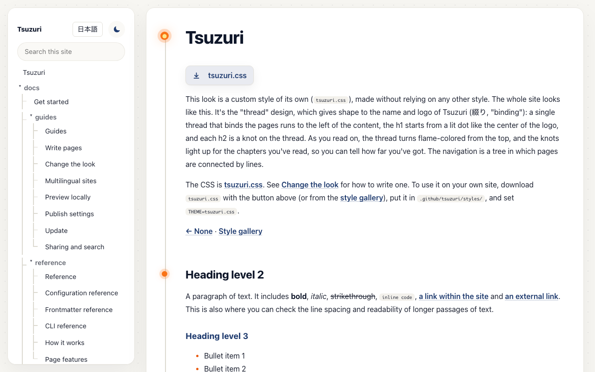
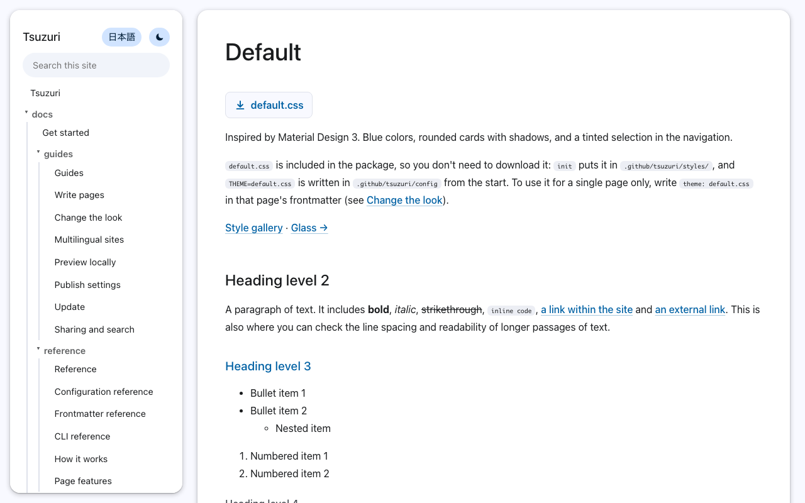
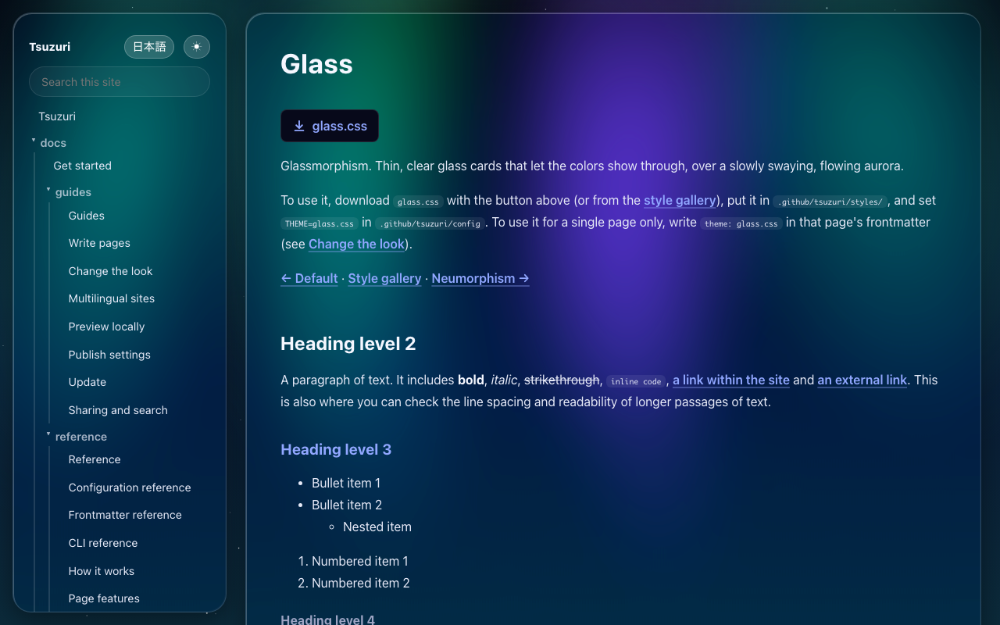
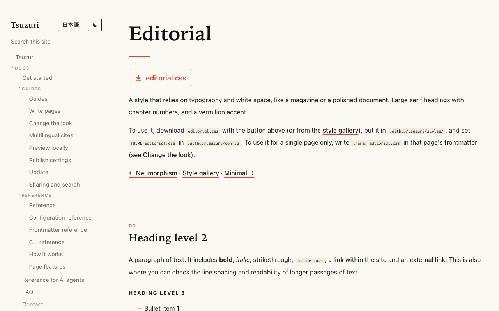
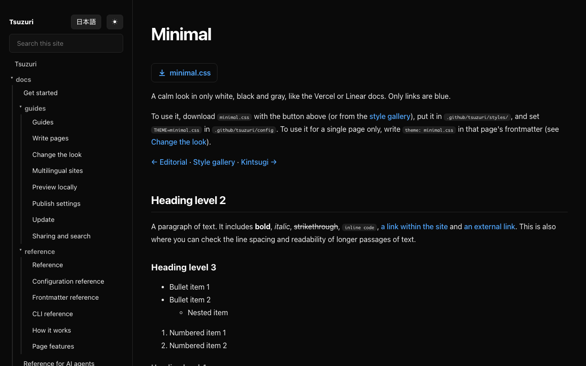
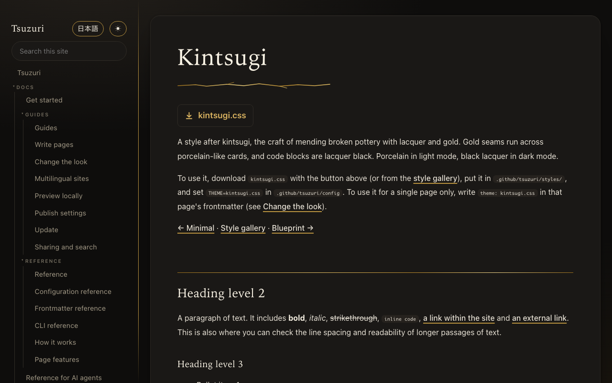
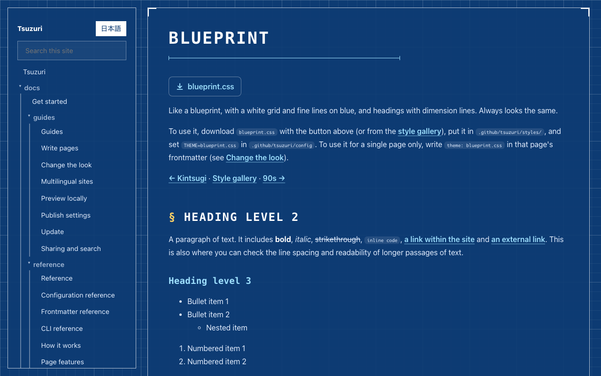

<div class="tsuzuri-hero" align="center">


# Tsuzuri

<p class="tsuzuri-hero-lead">Focus on your product. Your README becomes a beautiful docs site.</p>

<p class="tsuzuri-hero-sub">One command sets it up, and every push to your branch publishes it to GitHub Pages. No docs framework to learn, no theme to design, no second copy of your docs to keep in sync.</p>

```sh
npx github:akilasatolu/tsuzuri#v1 init
```

<p class="tsuzuri-hero-actions"><a class="tzr-button tsuzuri-button-primary" href="docs/getting-started.md">Get started</a><span class="tsuzuri-sep"> · </span><a class="tzr-button" href="gallery/style-gallery.md">Style gallery</a><span class="tsuzuri-sep"> · </span><a class="tzr-button" href="https://github.com/akilasatolu/tsuzuri">GitHub</a></p>

[](https://github.com/akilasatolu/tsuzuri/blob/main/LICENSE)
[](https://github.com/akilasatolu/tsuzuri/actions/workflows/ci.yml)

<picture>
<source media="(prefers-color-scheme: dark)" srcset="assets/gallery/tsuzuri-dark.png">

</picture>

</div>

## Made for product builders

Tsuzuri is for you if:

- You'd rather spend your time on the product than on building a docs site.
- You want docs that look finished, without designing a theme.
- You want to publish how-to guides on GitHub Pages, without learning a docs tool.

If your README (and a few pages it links to) already explains your product, that's all Tsuzuri needs.

## Live in three steps

1. Run `npx github:akilasatolu/tsuzuri#v1 init` at the root of your repository, and press Enter to accept the defaults for its two questions.
2. In your GitHub repository, open **Settings → Pages** and set Source to **GitHub Actions** (first time only).
3. Push to your default branch (usually `main`). From then on, every push to it updates the site.

There is nothing to keep installed on your machine: the build runs on GitHub Actions (only running `init` needs Node.js 20 or later). [Get started](docs/getting-started.md) explains each step in detail.

Prefer to let an AI agent set it up? Paste the [reference for AI agents](docs/ai-reference.md) into it.

## Your time goes to the product

Docs matter, but they shouldn't eat into your product time. Tsuzuri takes these off your plate.

| Your trouble | Tsuzuri's answer | Details |
|---|---|---|
| Docs tools take days to learn and configure, so the site never gets made. | One `init` and one settings file. No workflow YAML to write. | [Get started](docs/getting-started.md) |
| A plain site looks unfinished and loses readers in the first few seconds. | A themed site from the first build, with light and dark. Pick another look from the style gallery. | [Style gallery](gallery/style-gallery.md) |
| You write the same content twice, in the README and on a docs site, and one of them goes stale. | The README is the site: Tsuzuri follows its links, so there is no second copy. | [Write pages](docs/guides/write-pages.md) |
| Even after the site is up, tools and dependencies need upkeep. | Updating is one command: `init --update`. | [Update](docs/guides/update.md) |

So all you have to write is the README.

## Looks good from day one

Your site starts with a finished look. To change it, pick a style from the style gallery, put its CSS file in `.github/tsuzuri/styles/` and set `THEME` in `.github/tsuzuri/config` (for example `THEME=glass.css`). This site uses a style of its own, `tsuzuri.css`.

<div class="tzr-carousel">






</div>

[See all the styles in the style gallery](gallery/style-gallery.md).

## Everything a docs site needs, already on

<div class="tsuzuri-features">
<div class="tsuzuri-feature">
<h3>One site, from your links</h3>
<p>Pages and images linked from the README are collected automatically. To add a page, add one link. No sitemap or sidebar settings to maintain.</p>
</div>
<div class="tsuzuri-feature">
<h3>Easy to find your way</h3>
<p>A sidebar, site search, an in-page table of contents and copy buttons on code. GitHub alerts, footnotes and mermaid diagrams work as they do on GitHub.</p>
</div>
<div class="tsuzuri-feature">
<h3>Ready to share</h3>
<p>OGP images, a favicon, sitemap.xml, llms.txt for AI tools, and multilingual sites.</p>
</div>
<div class="tsuzuri-feature">
<h3>Safe to publish</h3>
<p>Broken links can stop the build before they go live, and the build dependencies are pinned by hash and checked for npm signatures.</p>
</div>
</div>

## When it's not a fit

Tsuzuri is not a fit for sites that are published somewhere other than GitHub Pages (Tsuzuri is for GitHub Pages only), or for documentation that keeps a separate copy for each version (there is one version of the site: the branch you publish).

## Documentation

- [Get started](docs/getting-started.md): publish your README as a site in three steps.
- [Style gallery](gallery/style-gallery.md): choose a look.
- [Guides](docs/guides/README.md): add pages, change the look, support more than one language, and more.
- [Reference](docs/reference/README.md): settings, frontmatter, commands and how the build works.
- [FAQ](docs/faq.md): answers to the common problems.
- [Contact](docs/contact.md): send a question or a wish.
- [Changelog (release notes)](https://github.com/akilasatolu/tsuzuri/releases)

## License

[MIT License](https://github.com/akilasatolu/tsuzuri/blob/main/LICENSE)
