# ギャラリー(Gallery)

Tsuzuriのカスタムスタイルの見た目を、実際に生成されたページで確認し、気に入ったものをダウンロードできます。
各スタイルには同じ見本(見出し・段落・リンク・リスト・表・コード・引用・画像)が並んだ見本ページがあるので、
見比べながら選んでください。スクリーンショットは、横にスクロールするとライトとダークの見た目を見られます。

## カスタムスタイルの使い方

カスタムスタイルは、`.github/tsuzuri/styles/`に置くCSSファイルです。ページの見た目は、
ベース(`base.css`)+ カスタムスタイル1つで決まります([スタイル(Theming)](theming.ja.md)参照)。

1. 下で気に入ったスタイルの、ボタンからCSSファイルをダウンロードする。
2. リポジトリの`.github/tsuzuri/styles/`に置く。
3. `.github/tsuzuri/config`の`THEME`を、そのファイル名に変える(例: `THEME=glass.css`)。

1ページだけで使う場合は、そのページのfrontmatterに`theme: glass.css`と書きます
([Frontmatterリファレンス](frontmatter.ja.md#theme)参照)。`default.css`はパッケージに入っているので、ダウンロードは要りません。
`init`が`.github/tsuzuri/styles/`に置き、設定ファイルも`THEME=default.css`で始まります。
`init --update`で上書きされるのは`default.css`だけで、自分で置いたスタイルは変わりません。

## デフォルト(default)

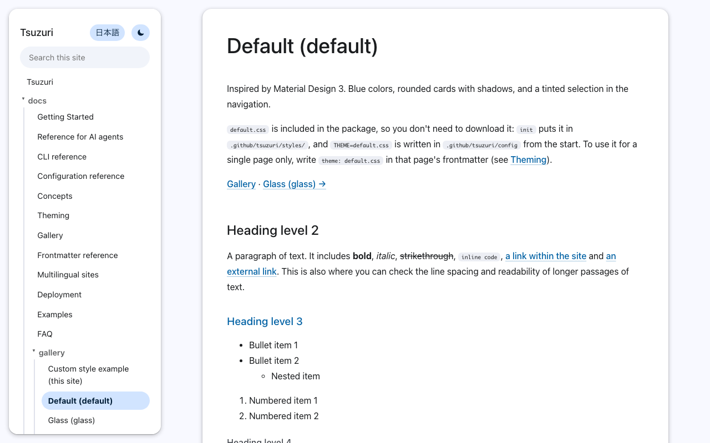
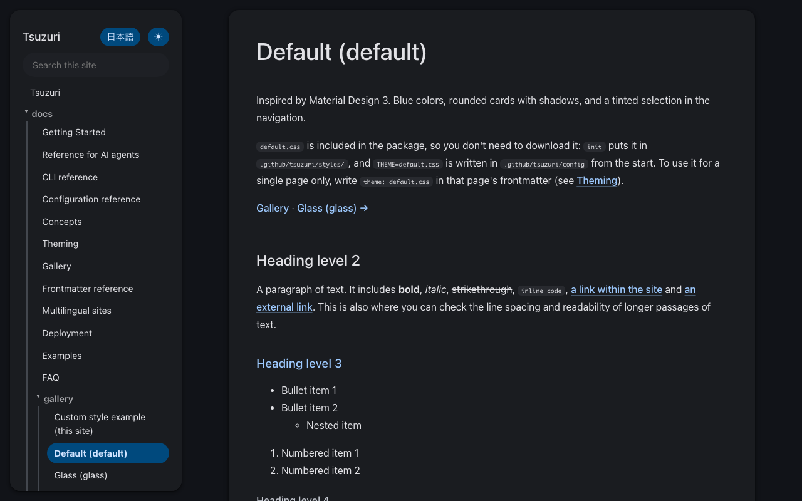

Material Design 3 風の標準スタイル(既定)。青系の配色、角丸のカードと影、トーンのついたナビの選択。ライト/ダークモードを自動で切り替える。

パッケージに入っているので、ダウンロードは不要です。`THEME=default.css`にします(既定)。

[見本ページ](gallery/default.ja.md)

## グラス(glass)

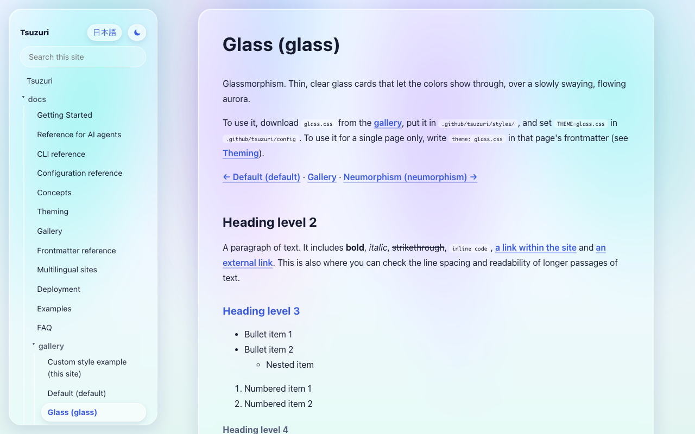
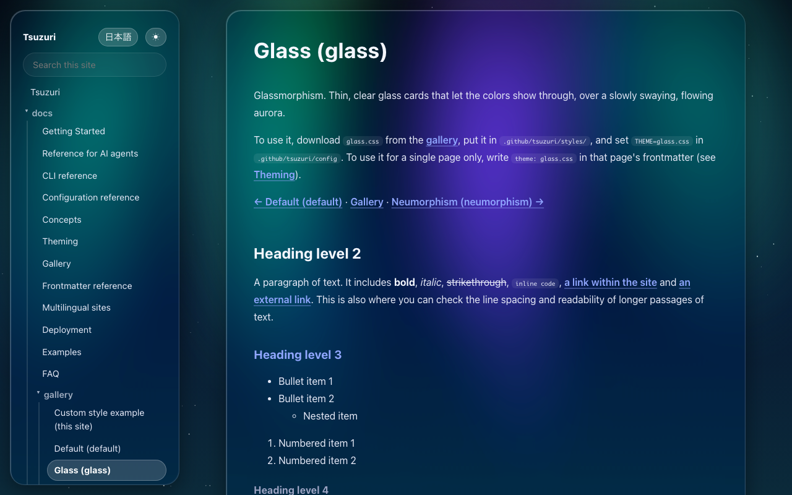

Glassmorphism。ゆっくり揺れて流れるオーロラの地に、色がそのまま透ける薄い透明なガラスのカード。

使い方: `.github/tsuzuri/styles/`に置いて、`THEME=glass.css`にします。

<a class="tsuzuri-button" href="../.github/tsuzuri/styles/glass.css" download>glass.css</a>

[見本ページ](gallery/glass.ja.md)

## ニューモーフィズム(neumorphism)

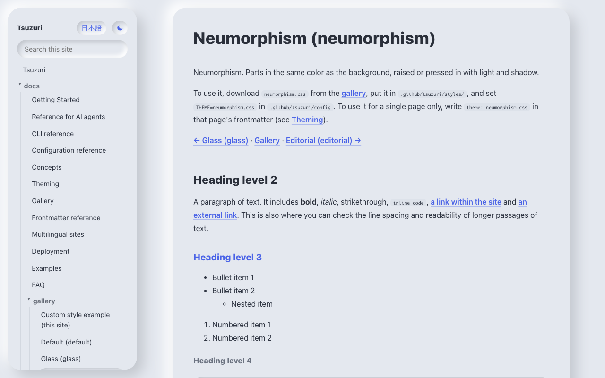
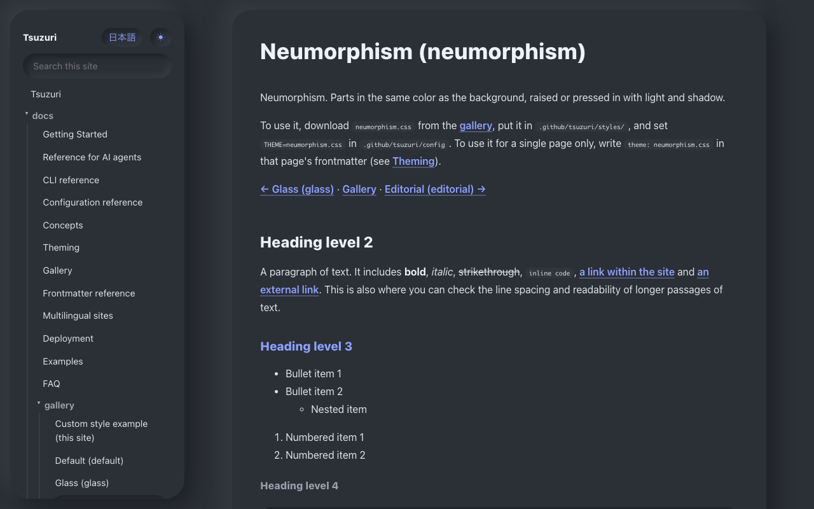

Neumorphism。地と同じ色の部品が、光と影で浮き出したりへこんだりする。

使い方: `.github/tsuzuri/styles/`に置いて、`THEME=neumorphism.css`にします。

<a class="tsuzuri-button" href="../.github/tsuzuri/styles/neumorphism.css" download>neumorphism.css</a>

[見本ページ](gallery/neumorphism.ja.md)

## エディトリアル(editorial)

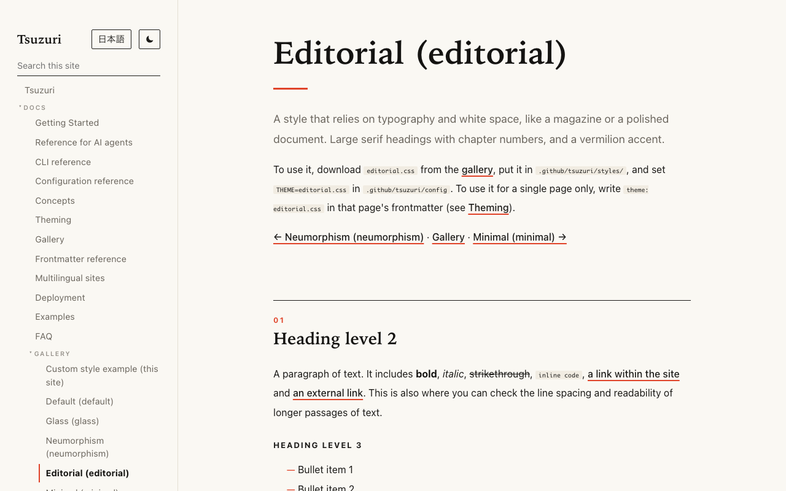
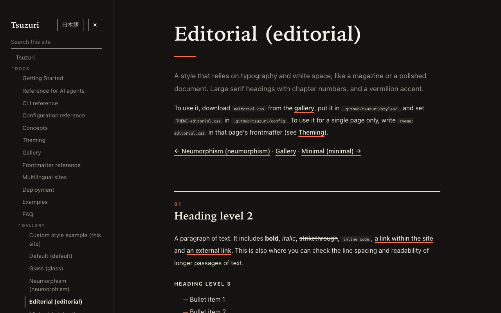

雑誌や上質なドキュメントのような、文字組と余白で見せるスタイル。大きな明朝体の見出しと章の番号、朱色の差し色。

使い方: `.github/tsuzuri/styles/`に置いて、`THEME=editorial.css`にします。

<a class="tsuzuri-button" href="../.github/tsuzuri/styles/editorial.css" download>editorial.css</a>

[見本ページ](gallery/editorial.ja.md)

## ミニマル(minimal)

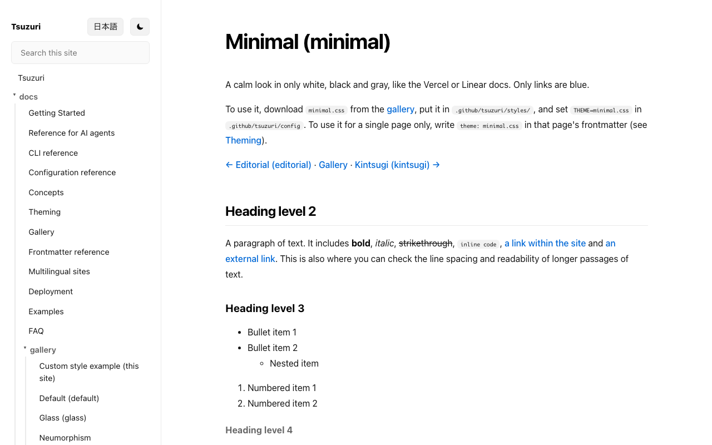
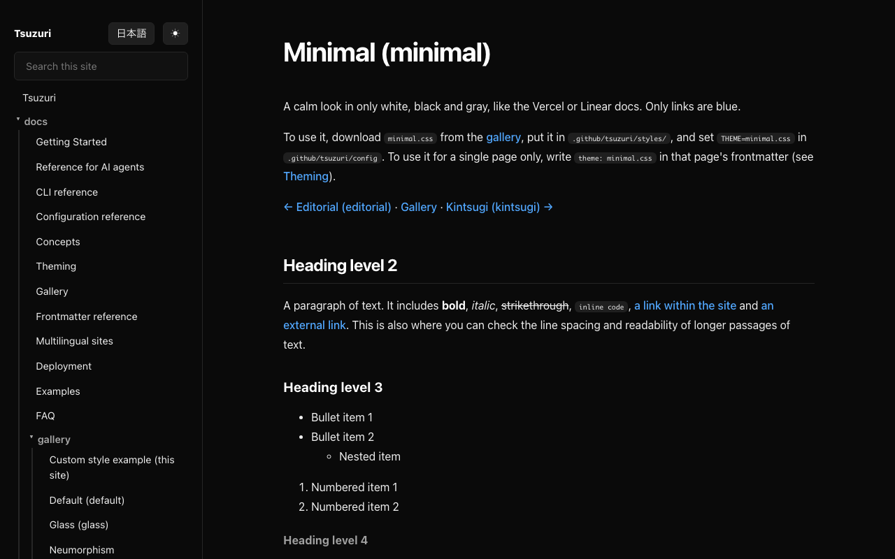

Vercel や Linear のドキュメントのような、白・黒・グレーだけの落ち着いた見た目。リンクだけ青。

使い方: `.github/tsuzuri/styles/`に置いて、`THEME=minimal.css`にします。

<a class="tsuzuri-button" href="../.github/tsuzuri/styles/minimal.css" download>minimal.css</a>

[見本ページ](gallery/minimal.ja.md)

## 金継ぎ(kintsugi)

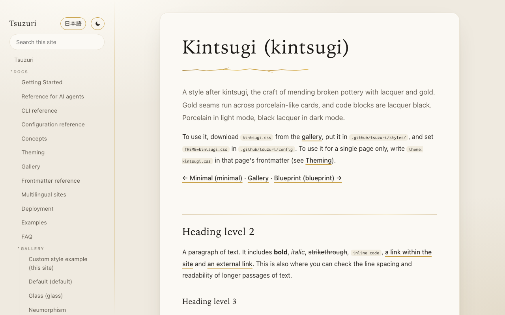
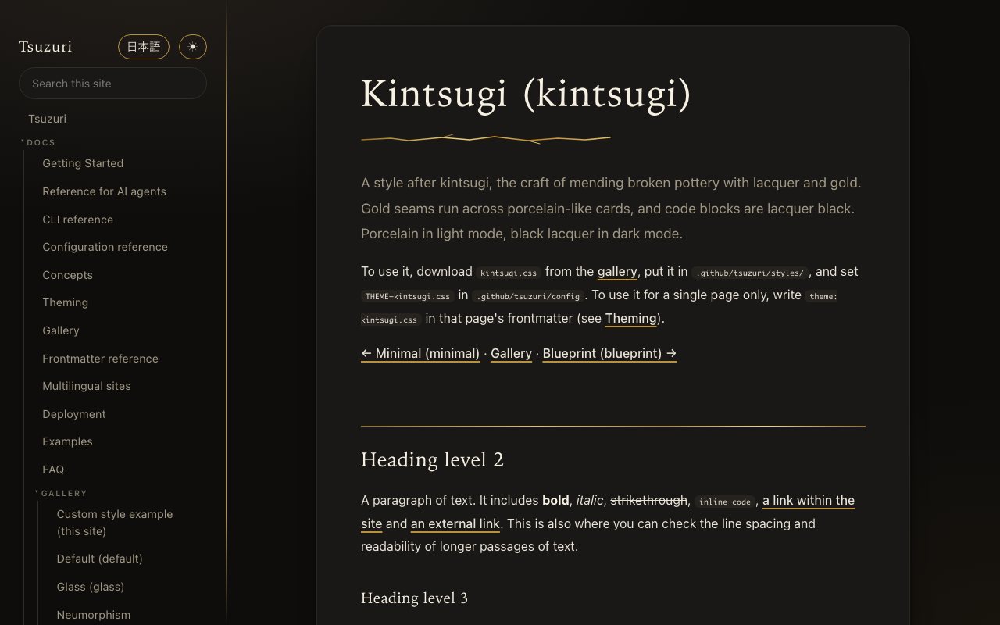

割れた器を漆と金で継ぐ「金継ぎ」のスタイル。白磁のようなカードに金の継ぎ目が走り、コードブロックは漆の黒。ライト表示は白磁、ダーク表示は黒漆。

使い方: `.github/tsuzuri/styles/`に置いて、`THEME=kintsugi.css`にします。

<a class="tsuzuri-button" href="../.github/tsuzuri/styles/kintsugi.css" download>kintsugi.css</a>

[見本ページ](gallery/kintsugi.ja.md)

## ブループリント(blueprint)

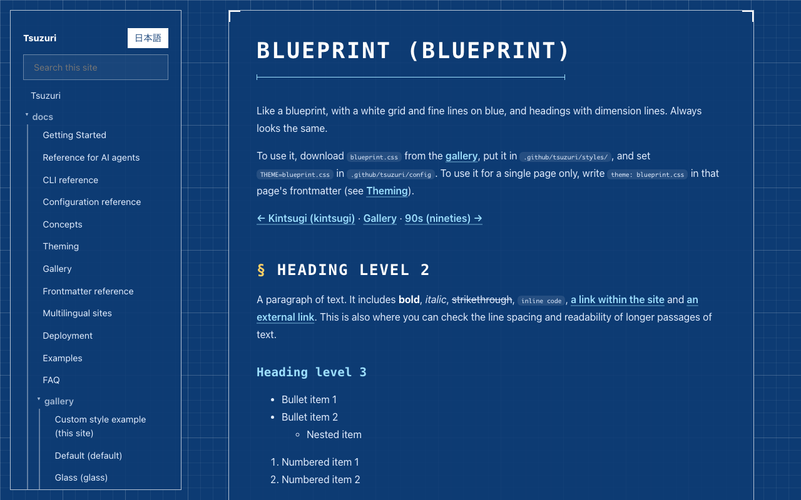

設計図(青焼き)のような、青い地に白い方眼と細線、寸法線付きの見出し。常に同じ表示。

使い方: `.github/tsuzuri/styles/`に置いて、`THEME=blueprint.css`にします。

<a class="tsuzuri-button" href="../.github/tsuzuri/styles/blueprint.css" download>blueprint.css</a>

[見本ページ](gallery/blueprint.ja.md)

## 90年代(nineties)

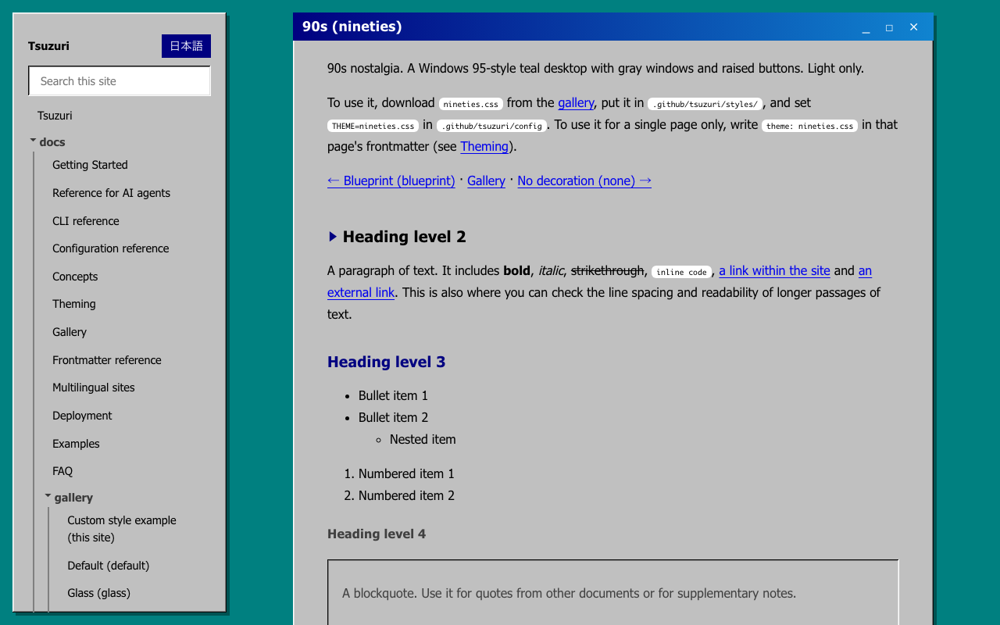

90s Nostalgia。Windows 95 風の青緑のデスクトップと灰色のウィンドウ、立体のボタン。ライト表示のみ。

使い方: `.github/tsuzuri/styles/`に置いて、`THEME=nineties.css`にします。

<a class="tsuzuri-button" href="../.github/tsuzuri/styles/nineties.css" download>nineties.css</a>

[見本ページ](gallery/nineties.ja.md)

## 装飾なし(none)

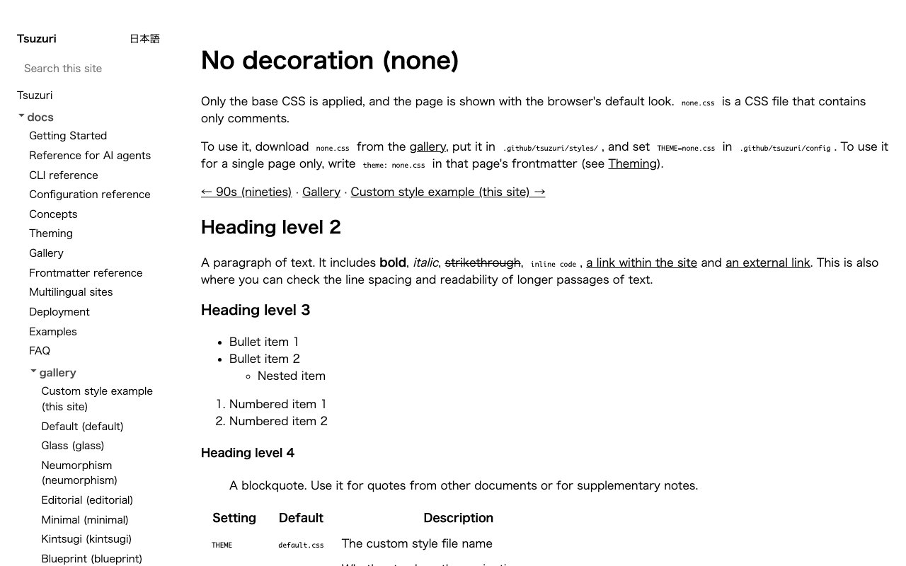

ベースだけを適用し、ブラウザ既定の見た目で表示します。`none.css`はコメントだけのCSSファイルです。

使い方: `.github/tsuzuri/styles/`に置いて、`THEME=none.css`にします。

<a class="tsuzuri-button" href="../.github/tsuzuri/styles/none.css" download>none.css</a>

[見本ページ](gallery/none.ja.md)

## Tsuzuri(このサイト)

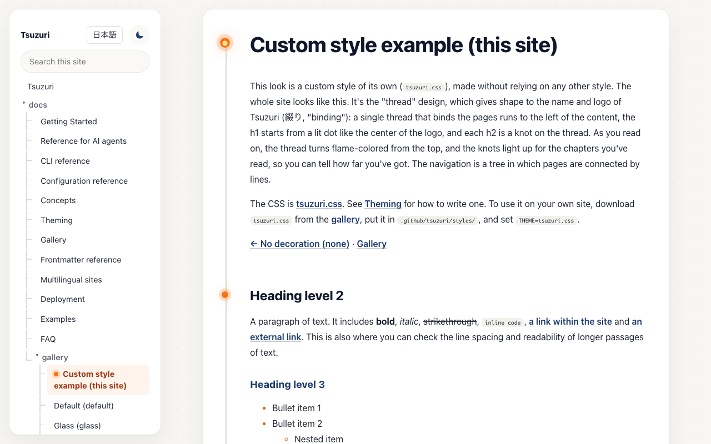
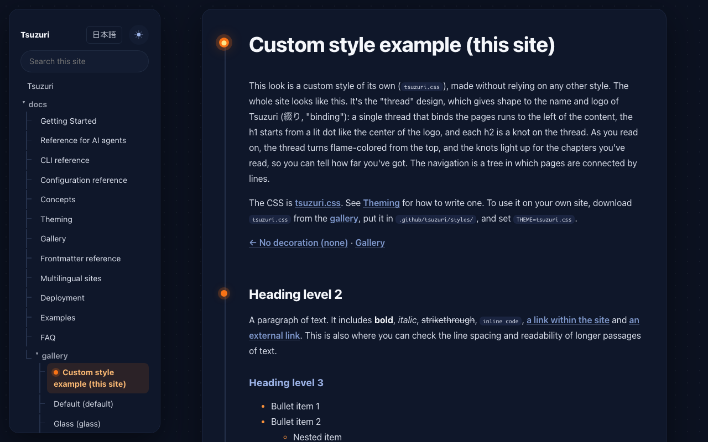

このサイト自身の見た目。自分用のカスタムスタイルだけで作っています。

使い方: `.github/tsuzuri/styles/`に置いて、`THEME=tsuzuri.css`にします。

<a class="tsuzuri-button" href="../.github/tsuzuri/styles/tsuzuri.css" download>tsuzuri.css</a>

[見本ページ](gallery/tsuzuri.ja.md)

配色をさらに細かく調整したい場合は、`default.css`を別の名前にコピーして、CSS変数(`--fg`・`--bg`・`--accent`など)を上書きし、`THEME`に指定します([スタイル(Theming)](theming.ja.md#自分でカスタムスタイルを作る)参照)。
